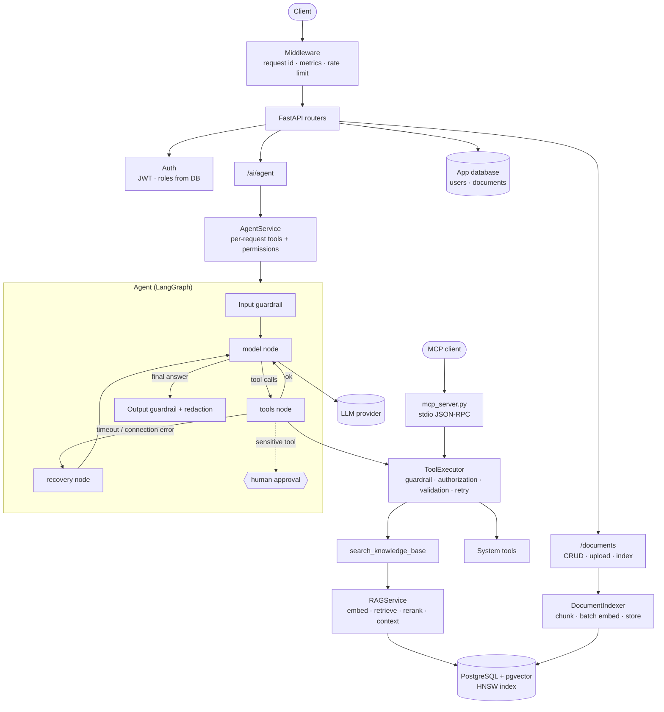

# Astra AI Platform


Astra is a backend for an enterprise AI assistant. It answers questions with an LLM agent that decides on its own whether it needs internal documents (RAG over PostgreSQL + pgvector), live system tools, both, or neither. Every step runs inside security boundaries: authentication, per-role tool permissions, permission-aware retrieval, human approval for destructive actions, guardrails, rate limits and secret redaction.

The project is built step by step as a portfolio project for AI engineering. It focuses on the engineering around the model: orchestration, retrieval, security, failure handling, observability, testing and deployment.

---

## Features

| Area | What is implemented |
| --- | --- |
| **Agent** | LangGraph state machine (`model → tools → model`, recovery path, planning steps), max tool rounds, max tool calls per round, step limit |
| **Agentic RAG** | `search_knowledge_base` tool: the model decides when to retrieve; the response reports the route taken (`normal`, `tool`, `rag`, `tool+rag`) and the sources |
| **Retrieval** | Chunking with overlap, OpenAI embeddings (`text-embedding-3-small`, 1536 dims), pgvector cosine search with an HNSW index, keyword reranker, score threshold |
| **Ingestion** | Upload `.txt`/`.pdf`, index into pgvector (batched embeddings, one transaction per document), automatic removal of stale chunks |
| **Permissions** | JWT auth, roles from the database; users only retrieve chunks of documents they can read; the model only sees tools its role may use |
| **Human-in-the-loop** | Sensitive tools pause the graph with `interrupt()`; `POST /ai/agent/approvals/{thread_id}` approves or rejects; state in memory or PostgreSQL |
| **Planning** | Optional plan → step-by-step execution with results passed between steps |
| **Memory** | Last turns per user and conversation |
| **Guardrails** | Input length, control and invisible characters, prompt-injection patterns (English and Persian), output length, secret redaction (API keys, JWTs, private keys, configured secrets) |
| **MCP** | Minimal Model Context Protocol server over stdio exposing the read-only tools |
| **Reliability** | Tool retry policy for transient errors, recovery node, provider errors mapped to `503`, readiness checks |
| **Observability** | Request ids, JSON logs with redaction, Prometheus metrics for HTTP, model, embedding, tool and RAG calls, token usage and estimated cost |
| **Performance** | Batched embeddings for indexing, LRU cache for query embeddings |
| **Evaluation** | Recall@k, MRR, keyword correctness, lexical groundedness, citation rate, route accuracy; offline regression gate in CI |
| **Delivery** | Docker Compose (API + pgvector), non-root image with healthcheck, GitHub Actions CI (tests, coverage gate, eval gate, image build) |

---

## Architecture



### What happens on `POST /ai/agent`

1. The JWT is validated; the user and role are loaded from the database.
2. `AgentService` builds the tool set for this request: system tools, a knowledge base tool restricted to the documents this user may read, and, for admins, `remove_knowledge_document`.
3. The input guardrail rejects empty, oversized, hidden-character or obvious prompt-injection input (`400`).
4. The model receives only the tools its role may use. It answers directly or calls tools.
5. Tool calls go through `ToolExecutor`: allow-list, role check, JSON and schema validation, retry for transient errors.
6. Retrieved text is marked as untrusted reference data. The answer is redacted before it is returned with `route`, `tools_used`, `recovered` and `sources`.
7. If a sensitive tool is called, the run pauses and returns `status: approval_required` with a `thread_id`.

---

## Quick start

### Docker (full stack)

```bash
cp .env.example .env        # set SECRET_KEY and OPENAI_API_KEY
docker compose up --build
```

API on http://localhost:8000, interactive docs at http://localhost:8000/docs.

### Local development

```bash
python -m venv .venv
.venv\Scripts\activate          # Windows; Linux/macOS: source .venv/bin/activate
pip install -r requirements-dev.txt
cp .env.example .env            # set SECRET_KEY and OPENAI_API_KEY

docker compose up -d postgres   # pgvector on localhost:5433
uvicorn main:app --reload
```

The RAG table, the `vector` extension and the indexes are created on startup.

---

## Using the API

```bash
# 1. Register and log in
curl -X POST localhost:8000/users/register -H "Content-Type: application/json" \
     -d '{"username": "sara", "password": "secret123"}'
TOKEN=$(curl -s -X POST localhost:8000/users/login -d "username=sara&password=secret123" | jq -r .access_token)

# 2. Upload a document and add it to the knowledge base
curl -X POST localhost:8000/documents/upload -H "Authorization: Bearer $TOKEN" -F "file=@policy.pdf"
curl -X POST localhost:8000/documents/1/index -H "Authorization: Bearer $TOKEN"

# 3. Ask the agent
curl -X POST localhost:8000/ai/agent -H "Authorization: Bearer $TOKEN" -H "Content-Type: application/json" \
     -d '{"message": "How many vacation days do we get?", "conversation_id": "chat-1"}'
```

```json
{
  "status": "completed",
  "answer": "Every employee receives 30 vacation days per year [Source 1].",
  "route": "rag",
  "tools_used": ["search_knowledge_base"],
  "recovered": false,
  "sources": [{"document_id": 1, "chunk_index": 0, "score": 0.83}],
  "conversation_id": "chat-1",
  "thread_id": null,
  "pending_tool_calls": []
}
```

Human approval (admin asking to remove a document from the knowledge base):

```bash
curl -X POST localhost:8000/ai/agent -H "Authorization: Bearer $ADMIN_TOKEN" -H "Content-Type: application/json" \
     -d '{"message": "Remove document 3 from the knowledge base"}'
# -> {"status": "approval_required", "thread_id": "user-1-…", "pending_tool_calls": [...]}

curl -X POST localhost:8000/ai/agent/approvals/user-1-… -H "Authorization: Bearer $ADMIN_TOKEN" \
     -H "Content-Type: application/json" -d '{"approved": true}'
```

### Endpoints

| Method | Path | Auth | Purpose |
| --- | --- | --- | --- |
| `GET` | `/health` | – | Liveness |
| `GET` | `/ready` | – | Readiness (app and RAG databases), `503` when a dependency is down |
| `GET` | `/metrics` | API key | Prometheus metrics |
| `POST` | `/users/register`, `/users/login` | – | Account and JWT |
| `GET` | `/users/profile` | user | Current user |
| `GET/POST/PATCH/DELETE` | `/users/…` | admin | User management |
| `POST/GET/PUT/DELETE` | `/documents/…` | optional / owner | Documents with private/public visibility |
| `POST` | `/documents/upload` | optional | Upload `.txt` or `.pdf` |
| `POST` | `/documents/{id}/index` | owner or admin | Add to the knowledge base |
| `POST` | `/ai/agent` | user | Agent with tools and knowledge base |
| `POST` | `/ai/agent/approvals/{thread_id}` | run owner | Approve or reject a paused run |
| `POST` | `/ai/generate`, `/ai/chat`, `/ai/chat/stream` | – | Direct model access (`/generate` picks a prompt by intent; `/chat/stream` streams text) |

---

## MCP server

```bash
python -m mcp_server
```

Implements `initialize` (protocol version negotiation), `ping`, `tools/list` and `tools/call` over stdio. Calls go through the same `ToolExecutor`, with the lowest role. Example client configuration:

```json
{
  "mcpServers": {
    "astra": {
      "command": "python",
      "args": ["-m", "mcp_server"],
      "cwd": "/path/to/astra-ai-platform"
    }
  }
}
```

The server is written against the specification without the SDK, to show the protocol itself. It covers tools only (no resources or prompts).

---

## Testing

```bash
python -m pytest                          # everything (needs pgvector on :5433)
python -m pytest -m "not integration"     # unit tests only, no database
python -m pytest --cov                    # coverage (93%)
ASTRA_RUN_LIVE_TESTS=1 python -m pytest -m live   # real LLM provider
```

- **407 tests** (403 by default, 4 opt-in live tests): unit, integration (real pgvector) and end-to-end (HTTP → agent → retriever → pgvector).
- Only the external providers are faked in tests: a scripted LLM and a deterministic hashing embedder.
- Tests use a separate `<database>_test` database that is created automatically, so the development knowledge base is never touched.
- Live tests that call the real model are opt-in.

## Evaluation

```bash
python -m evals.run           # offline: retrieval with a hashing embedder
python -m evals.run --live    # OpenAI embeddings + full agent evaluation
```

The dataset (`evals/dataset.json`) is indexed under reserved document ids and removed afterwards. The command exits with `1` when a metric is below its threshold, and CI runs the offline mode as a regression gate.

| Metric | What it measures |
| --- | --- |
| Recall@k, MRR | Whether and how high the right chunk is retrieved |
| Route accuracy | Whether the agent chose `normal` / `tool` / `rag` as expected |
| Keyword correctness | Whether expected facts appear in the answer |
| Groundedness | Share of the answer's content words found in the retrieved context |
| Citation rate | Whether RAG answers cite their sources |

Offline baseline on the included 5-document dataset: Recall@3 = 1.0, MRR = 1.0. The dataset is small and controlled, so these numbers show the harness works and catch regressions; they are not a quality claim. Groundedness and correctness are lexical heuristics. Semantic judgement would need an LLM judge or human review.

---

## Configuration

All settings come from environment variables or `.env` (see `.env.example`).

| Variable | Default | Notes |
| --- | --- | --- |
| `SECRET_KEY` | – | JWT signing key, at least 32 characters |
| `DATABASE_URL` | – | App database (SQLite locally, PostgreSQL in Docker) |
| `RAG_DATABASE_URL` | – | PostgreSQL with pgvector |
| `OPENAI_API_KEY`, `OPENAI_MODEL` | – | LLM and embeddings |
| `INTERNAL_API_KEY` | – | Protects `/metrics`; empty disables it |
| `AGENT_CHECKPOINTER` | `memory` | `postgres` keeps paused runs across restarts and workers |
| `RATE_LIMIT_PER_MINUTE` / `AI_RATE_LIMIT_PER_MINUTE` | `120` / `20` | Per IP and path / per user for `/ai/*` |
| `LLM_*_COST_PER_1M_TOKENS`, `EMBEDDING_COST_PER_1M_TOKENS` | `0` / `0.02` | Prices for the cost estimate |
| `CORS_ORIGINS` | localhost | JSON list |
| `LOG_LEVEL` | `INFO` | |

---

## Design decisions

- **Retrieval as a tool, not always-on context.** The model calls `search_knowledge_base` only when needed. General questions skip the embedding call and the context tokens. The trade-off is that the model can decide wrongly, which is why route accuracy is evaluated.
- **Permissions are applied before retrieval, not after.** The retriever receives an allow-list of document ids, so private chunks never reach the model, even if a prompt injection asks for them.
- **The model only sees allowed tools.** Authorization is checked again on execution (defence in depth).
- **Fail closed on security errors.** Unknown or forbidden tools and invalid arguments stop the run instead of being retried.
- **Human approval through LangGraph `interrupt()`.** The graph state is checkpointed, so a paused run can resume later, in another process when using PostgreSQL.
- **Separate liveness and readiness.** `/health` never touches dependencies; `/ready` does.
- **Cache only what is deterministic.** Query embeddings are cached. Model answers and retrieval results are not, because they depend on the user, permissions and the current index.

## Known limitations

- Rate limits, metrics and conversation memory are in process memory. Multiple workers need Redis and a metrics backend (or OpenTelemetry).
- The keyword reranker is a simple baseline, not a learned reranker.
- The prompt-injection check matches patterns. It is one layer; tool permissions, approval and redaction limit the damage when an injection gets through.
- Schema changes use `create_all` plus small SQLite migrations; a production deployment should use Alembic.
- Evaluation metrics are lexical heuristics on a small dataset.

---

## Project structure

```text
agents/        Agent, LangGraph graph, planner, guardrails, memory, checkpointer
rag/           chunking, embeddings (+ cache, hashing baseline), indexer,
               retrieval, reranking, context, prompt, evaluation metrics
tools/         tool base, registry, executor, guardrail, authorization, retry,
               system tools, knowledge base tools
services/      agent service, AI service, documents, users, providers
router/        FastAPI routers (ai, documents, users)
evals/         evaluation dataset and runner
mcp_server.py  MCP server (stdio)
observability.py, redaction.py, rate_limit.py, security.py, dependency.py
tests/         unit, integration and end-to-end tests
```
